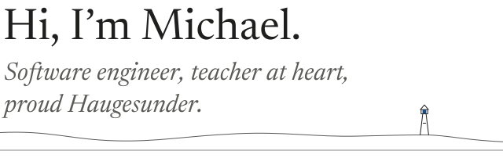

<picture>
<source media="(prefers-color-scheme: dark)" srcset="assets/banner-dark.svg">

</picture>

I build backends and the tools around them. When I'm not at a keyboard, I'm usually on the water.

At [Telenor](https://www.telenor.no/) since 2022. From Haugesund, based in Bærum. Kotlin by day, Rust by night.

## Things I built

If something bugs me long enough, I build a fix. Then I use it every day.

- **Fernly**, coming soon for iPhone and Android. A private medication and health journal. No account, no server, no analytics. Your records live in an encrypted database on your phone.
- **[Ward](https://github.com/OriginalMHV/Ward)**, an open source Rust CLI. GitHub repository settings as code: describe what you want in a `ward.toml`, then plan, apply and verify it across many repositories at once.
- **[minimenta](https://github.com/OriginalMHV/minimenta)**, a Rust terminal disk usage analyzer. It feels like ncdu, scans faster, and lets you move many items to the Trash in one step.

## The part I like most

People. I genuinely like helping others grow. Before Telenor I was a teaching assistant at the University of Agder, and it never really left me. Today I mentor juniors, and I like writing the docs I wish existed when I started.

## Lately

<!-- lately:start -->
- **[Ward](https://github.com/OriginalMHV/Ward)** [v0.6.2](https://github.com/OriginalMHV/Ward/releases/tag/v0.6.2) (latest) · 2026-10-15 The warnings for deprecated aliases now say that Ward removes them in 0.7.0.
- **[Ward](https://github.com/OriginalMHV/Ward)** [v0.6.1](https://github.com/OriginalMHV/Ward/releases/tag/v0.6.1) · 2026-10-14 Updated rustls to 0.23.46 to fix RUSTSEC-2026-0346, RUSTSEC-2026-0347...
- **[minimenta](https://github.com/OriginalMHV/minimenta)** [v0.1.0](https://github.com/OriginalMHV/minimenta/releases/tag/v0.1.0) · 2026-10-10 The Changed and Fixed lists describe changes since earlier builds from the main branch.
- **[Recall](https://github.com/OriginalMHV/Recall)** [v0.1.1](https://github.com/OriginalMHV/Recall/releases/tag/v0.1.1) · 2026-03-24 OpenAI Codex CLI provider.

Updated weekly from my GitHub releases.
<!-- lately:end -->

## Find me

[michaelhv.no](https://michaelhv.no) · [LinkedIn](https://www.linkedin.com/in/michaelhv)

<picture>
<source media="(prefers-color-scheme: dark)" srcset="assets/coast-dark.svg">

</picture>
